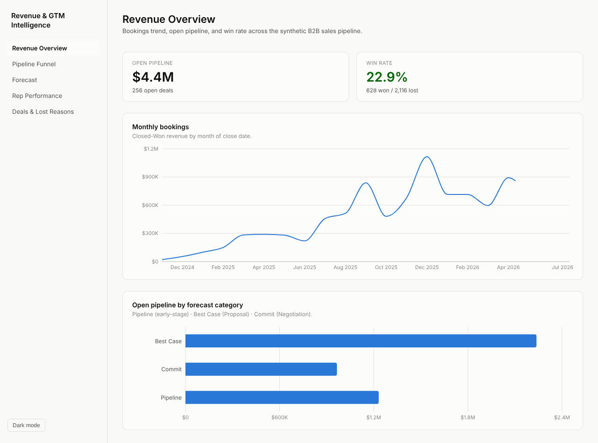
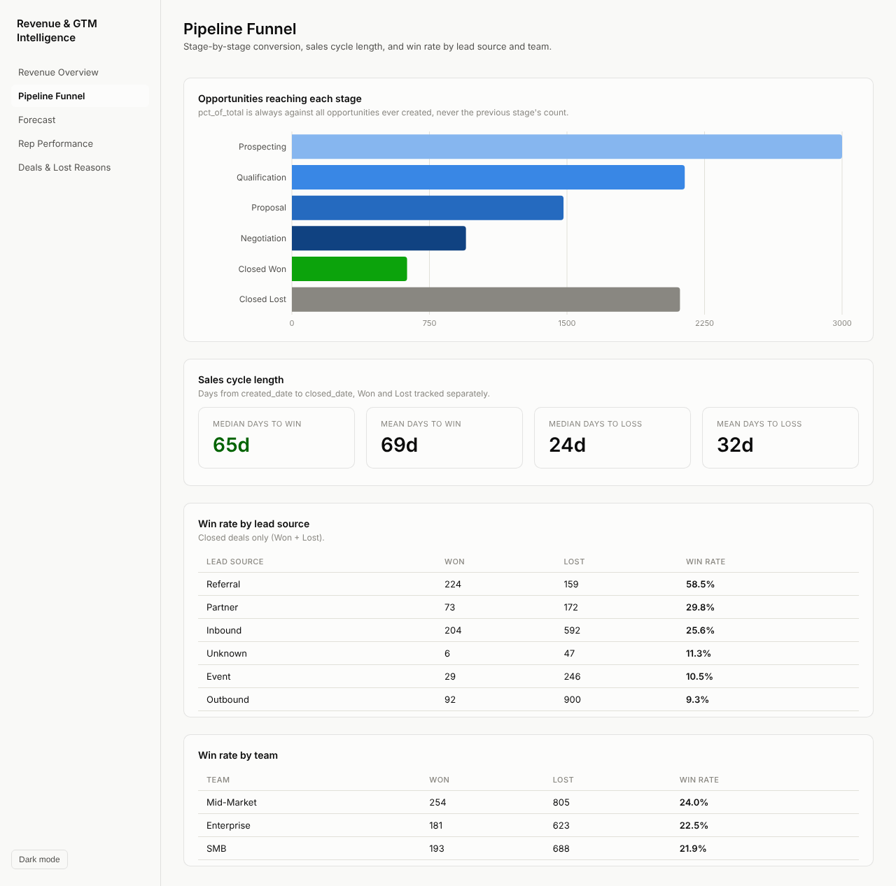
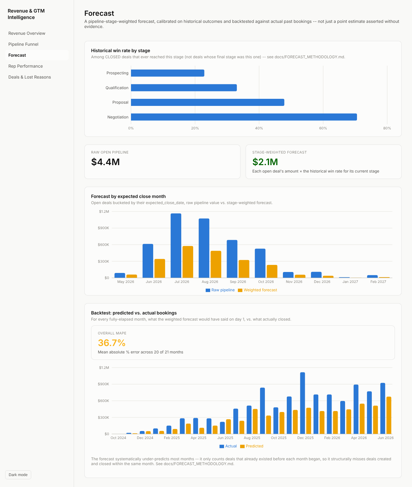
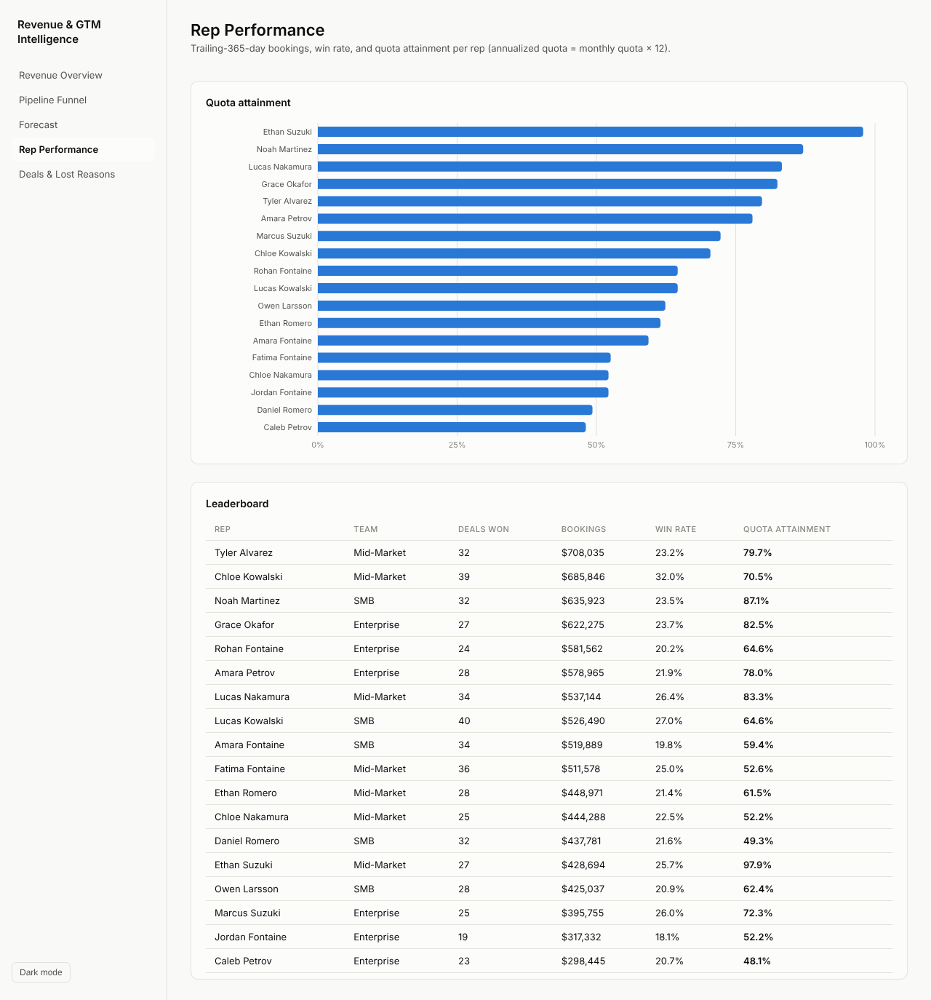
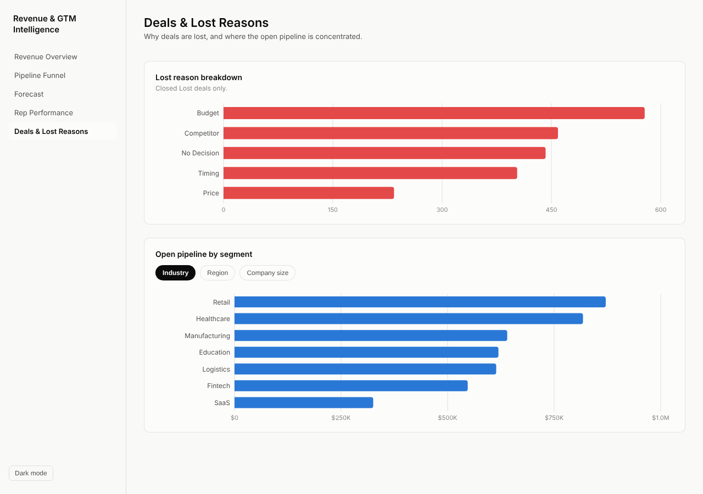

# Revenue & GTM Operations Intelligence

A self-contained B2B sales pipeline analytics stack: a deterministic
synthetic CRM dataset, a DuckDB metrics and forecasting engine, a FastAPI
read-only API, and a React + TypeScript dashboard built around a
probability-weighted pipeline forecast that is **backtested against real
historical outcomes** and reports its own error honestly.

**All data is synthetic**, generated deterministically from a fixed seed.
No real CRM, customer, or sales data is used anywhere — see
`docs/DATA_DICTIONARY.md`.

Read `docs/CASE_STUDY.md` for the portfolio write-up, including what the
generated data actually shows and what the forecast backtest found.

## Architecture

```
generator/generate.py  →  generator/data/raw/*.csv  →  db/load.py  →  db/gtm.duckdb
                                                                            │
                                                     db/metrics.py, db/forecast.py
                                                                            │
                                                          api/app  (FastAPI, read-only)
                                                                            │
                                                              web/  (React + TS + Vite)
```

- **`generator/`** — deterministic synthetic CRM data generation (NumPy
  seeded `Generator`): 18 sales reps, 600 accounts, 3,000 opportunities
  that progress through a strictly sequential pipeline. Re-running it with
  the same `SEED` produces byte-identical CSVs.
- **`db/`** — DuckDB schema (`sql/001_schema.sql`), the event-sourced
  stage-progress view (`sql/002_views.sql`), the load script, and the two
  Python modules (`metrics.py`, `forecast.py`) that are the **single
  source of truth** for every number the API and dashboard show.
- **`api/`** — FastAPI app. Every route is a thin wrapper over
  `db/metrics.py` / `db/forecast.py`; it holds no analysis logic of its own.
- **`web/`** — React + TypeScript + Vite dashboard (Recharts), light/dark
  themes, a validated colorblind-safe palette.

## Setup

Requires Python 3.11+ and Node 20+.

```bash
# 1. Generate the synthetic dataset (reproducible)
cd generator && pip install -r requirements.txt
python generate.py

# 2. Build the DuckDB database from the generated CSVs (uses the same deps from step 1)
cd ../db
python load.py

# 3. Run the API
cd ../api && pip install -r requirements.txt
uvicorn app.main:app --reload --port 8000

# 4. Run the dashboard (in a separate terminal)
cd ../web && npm install
npm run dev
```

The dashboard expects the API at `http://localhost:8000` by default
(`web/.env` → `VITE_API_BASE_URL`).

## Tests

```bash
# Generator, metrics, and forecast engine (31 tests)
cd /path/to/revenue-gtm-intelligence && pip install -r generator/requirements.txt
python -m pytest tests/ -v

# API (19 tests — requires the database built per step 2 above)
cd api && python -m pytest tests/ -v

# Frontend (24 tests)
cd web && npm run test
```

## Dashboard

| Revenue Overview | Pipeline Funnel |
|---|---|
|  |  |

| Forecast | Rep Performance |
|---|---|
|  |  |

| Deals & Lost Reasons |
|---|
|  |

## Documentation

- [`docs/DATA_DICTIONARY.md`](docs/DATA_DICTIONARY.md) — tables and the
  pipeline model (why winning requires reaching Negotiation)
- [`docs/METRIC_DEFINITIONS.md`](docs/METRIC_DEFINITIONS.md) — the prose
  definition of every metric in `db/metrics.py`
- [`docs/FORECAST_METHODOLOGY.md`](docs/FORECAST_METHODOLOGY.md) — the
  weighting scheme, the point-in-time backtest, and what it found
  (including its systematic under-prediction bias)
- [`docs/CASE_STUDY.md`](docs/CASE_STUDY.md) — portfolio write-up with
  live results from the generated data

## Tech stack

Python (NumPy, pandas, DuckDB, FastAPI, pytest) · TypeScript (React,
Vite, Recharts, Vitest, React Testing Library)
